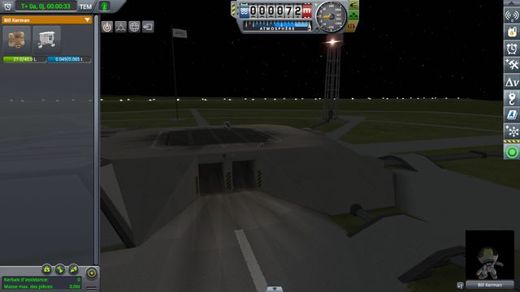
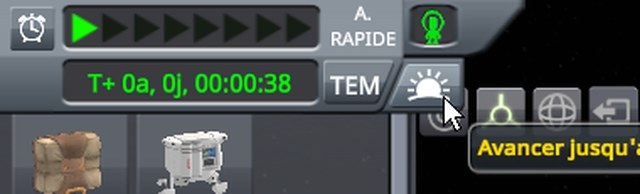
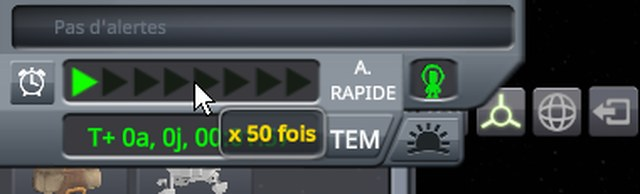

# Construction Toolbar Fix

**⚠️ Not finished yet.** This is a new fix, not a finished mod. The code and the conclusions on this page can still change.

A fix for stock KSP 1.12, kept as small as possible: two Harmony patches, each putting one component on the
flight interface, each in one source file. It is a mod of its own, built on top of
[KSP Community Fixes](https://github.com/KSPModdingLibs/KSPCommunityFixes), the base most players run.
Here is what it fixes:

> **In EVA construction mode, a click on the Place tool, the first of the tools at the top left of the screen,
> warps time to the next morning.** The pointer resting on the top of the tool slides down the warp-to-morning
> drawer of the time display, whose sunrise button lands under the pointer and takes the click.

> **With the next alarm shown above the time display, the time display covers the top of the construction
> mode.** The alarm clock button slides the time display down, over the first row of the list of parts and the
> top of the tools, which stay where they are.

**How this was made.** The investigation and the code were written with Claude, Anthropic's AI
assistant. Everything here was reviewed and validated by a human — me. I am saying so up front, because
contributions made with an AI deserve a closer look than others, and because some people would rather
stop reading here. That look should be quick: the stock code involved is named on this page, every check
below is read on screenshots of the game, taken by a public script that plays its protocol and checks its
outcome, and the fix is two source files you can read in a few minutes.

## Why it matters

In EVA construction mode, an engineer on EVA gets a list of parts at the left of the screen and four buttons at
its top right: the Place, Move and Rotate tools, and the exit. They sit right below the time display, at the top
left of the screen.



On stock, the pointer resting on the top of the Place tool slides down the drawer of the time display, and its
sunrise button, *Warp to next morning*, lands under the pointer, its tooltip showing:



The click meant for the Place tool then warps time to the next sunrise. The Move tool stays selected. The drawer opens over nothing that shows: a player aiming at the tool has no warning.


And with the next alarm shown, it gets worse. The alarm clock button, left of the time display, shows the next
alarm in a row above it and slides the time display down, while the construction mode stays where it is: the
time display covers the top of the tools and the first row of the list, the kerbal's own inventory. The pointer
brought there opens the drawer, which comes down further still.




*KSP 1.12.5 without this mod, with [KSP Community Fixes](https://github.com/KSPModdingLibs/KSPCommunityFixes)
1.41.1, in French, in a 1280 × 720 window, interface at 100 %, an engineer on EVA next to a small capsule on the
launch pad, at night. Screenshots do not show the mouse cursor: it is drawn where it was. All but the first are
cropped from the top left of the screen and zoomed. First, the next alarm hidden, the construction mode is opened
and the Move tool clicked; then the pointer, coming from the middle of the screen, rests on the top of the Place
tool, a quarter of the way down, and clicks there. The last two: the alarm clock button clicked, in construction
mode, then the pointer resting on the middle of the first row of the list.*

## The culprits

### The drawer's mask takes the pointer, the drawer closed

The time display in flight (`TimeFrame/TimeQuadrant`) carries a `UITimeWarpHoverController`, a
`UIHoverSlidePanel`: while the pointer is over any of its children (`OnPointerEnter`, `OnPointerExit`), it
slides down and shows the drawer of `UIWarpToNextMorning`, its sunrise button. That drawer is clipped by a
`Mask`, `WarpToSunriseMask` (the controller's `fixedMask`), that does not move with it.

- **The mask's image takes the pointer.** A `Mask` clips with the image of its object, and that `Image` is a
  raycast target. So, the drawer closed, the mask is an invisible rectangle below the time display that takes
  the pointer, and with it the hover of the time display. It reaches over the space below the time display,
  where nothing shows, and over the top half of the Place tool, its middle included: a click on the middle of
  the tool is lost too ([Checking the construction tools](docs/checking-tools.md)).
- **The drawer then opens under the pointer.** Resting there, the pointer slides the drawer down; its sunrise
  button lands right under the pointer, over the top of the Place tool, and takes the next click. The tooltip
  of the Place tool does not show there.
- **Open, the mask is needed.** Between the time display slid down and the sunrise button, the mask is what
  keeps the pointer over the time display on its way to the button: without it, the drawer closes on the way.

### The time display slides down over the construction mode

`FlightUIModeController.NextAlarmToggle` moves the time display's `In` position (`timeFrame`, a
`UIPanelTransition`) from `withoutNextAlarm` to `withNextAlarm`, 32 units further down, to make room for the
next alarm. The construction mode's block (`EVA Construction Mode`, placed by the `constructionModeTransition`
of `EVAConstructionModeController`) is not told: the time display, drawn after it, covers its top.

## The fixes

Two patches, each with its own switch in [Settings](#settings), both on by default. Nothing is saved; removing
the mod gives the stock behaviour back at once.

- **`closedDrawerLetsPointerThrough`.** After `UIHoverSlidePanel.Start`, for the time display's controller
  only, the mod puts a component on the drawer's mask that implements `ICanvasRaycastFilter`. Before an image
  takes the pointer, Unity asks every such filter on the image and on its parents (`Graphic.Raycast`), so the
  one component answers for the mask, the drawer and its sunrise button. It turns the pointer down only while
  the drawer is closed, resting at its normal position (`MoveToState` ends a slide there exactly). Open, or
  sliding, the drawer takes the pointer as on stock.
- **`constructionModeBelowAlarm`.** After `EVAConstructionModeController.Start`, the mod puts a component on the
  construction mode's block that follows `FlightUIModeController.NextAlarmShowing`. With the next alarm shown,
  it moves both states of the block's transition, `In` and `Out`, down by as much as the time display moves,
  and shrinks the block by as much: the block stretches over the screen's height, its pivot at its top, so its
  top comes down and its bottom stays in place. With the next alarm hidden, it puts them back.

**Why not stop the mask taking the pointer altogether.** With `raycastTarget = false` on its image, the drawer
would no longer stay open on the way from the time display to the sunrise button.

**Why not move the tools alone.** With the next alarm shown, the time display also covers the first row of the
list of parts, the kerbal's own inventory.

## Checked: the construction tools

In construction mode, the Move tool is clicked, then the top of the Place tool, then the Rotate tool and the
middle of the Place tool. On stock, both clicks on the Place tool are lost, the first one warping to the morning;
with this mod, both select it, and time does not warp.

**→ Full chapter: [Checking the construction tools](docs/checking-tools.md)**

## Checked: the warp-to-morning drawer

Out of construction mode, the pointer rests below the time display, then goes from the date to the sunrise
button and clicks it. On stock, the drawer opens from below the time display; with this mod, only from the time
display, and its button still warps to the morning.

**→ Full chapter: [Checking the warp-to-morning drawer](docs/checking-drawer.md)**

## Checked: the construction mode with the next alarm

In construction mode, the next alarm is shown, the tools clicked and the first row of the list hovered, then the
next alarm hidden and the tools clicked again. On stock, the time display covers them; with this mod, the whole
construction mode moves down and back up with it.

**→ Full chapter: [Checking the construction mode with the next alarm](docs/checking-alarm.md)**

## Checked: other screen sizes and interface scales

The three protocols are played again at 1280 × 720 with the interface at 80 % and 150 %, then with the time
display alone at 80 % and 150 %, and at 1920 × 1080 with the interface at 100 % and 150 %. On stock, the defects
show in each, the time display at 150 % also taking the clicks on the Move and Rotate tools; with this mod, every
tool responds.

**→ Full chapter: [Checking other screen sizes and interface scales](docs/checking-interface-scales.md)**

## Checked: the tracking station

In the tracking station, the warp-to-morning button is always shown, without a drawer, and this mod puts nothing
there. It is clicked with nothing selected, then with the kerbal selected. On stock as with this mod, it is
greyed until a vessel is selected, then warps to the morning.

**→ Full chapter: [Checking the tracking station](docs/checking-station.md)**

## Testing it automatically

[run-tools.py](diag/automation/run-tools.py) plays the four protocols above, the construction tools, the drawer,
the next alarm and the tracking station, through
[KSP-Util-MCPServer](https://github.com/lhervier/KSP-Util-MCPServer), and checks their outcome. Python 3 only,
nothing to install: start KSP with KSP-Util-MCPServer, copy [construction-toolbar.sfs](diag/construction-toolbar.sfs)
into a sandbox game, then run:

```
python run-tools.py --folder <your sandbox game> --out out
```

It takes a few minutes, takes the screenshots the pages show, and ends with a list of checks, each printed PASS
or FAIL, then exits with 0 when all pass, 1 otherwise. The checks marked (fix) are what this mod promises: they
fail without it. The others hold on stock too.

```
PASS tools   the click on the middle of the Move tool selects it
PASS tools   (fix) the top of the Place tool takes the click
PASS tools   (fix) the click on the top of the Place tool selects it
PASS tools   (fix) the click on the top of the Place tool does not warp time
PASS tools   the click on the middle of the Rotate tool selects it
PASS tools   (fix) the click on the middle of the Place tool selects it
PASS drawer  (fix) the pointer below the time display does not bring the sunrise button under it
PASS drawer  from the date, the pointer reaches the sunrise button
PASS drawer  the click on the sunrise button warps to the morning
PASS alarm   (fix) the next alarm showing, the top of the Place tool takes the click
PASS alarm   (fix) the next alarm showing, the click on the top of the Place tool selects it
PASS alarm   (fix) the next alarm showing, the header of the first container of the list shows under the pointer
PASS alarm   the next alarm hidden again, the click on the middle of the Move tool selects it
PASS alarm   (fix) the next alarm hidden again, the click on the top of the Place tool selects it
PASS station the kerbal selected, the click on the tracking station's warp-to-morning button warps to the morning
15 of 15 checks passed
```

## Work in progress

What a player would see if this mod broke something, and how to try it by hand, with the mod and without:

- **Other mods that change the top left of the screen.** A mod that moves or rescales the time display, or the
  construction mode, could change what lies under the tools. With such a mod installed, play the three protocols
  by hand.

## Install

Copy the `GameData\KSPFixConstructionToolbar` folder into the `GameData` folder of KSP. It needs
[Harmony](https://github.com/KSPModdingLibs/HarmonyKSP), as KSP Community Fixes does.

## Settings

`GameData\KSPFixConstructionToolbar\PluginData\settings.cfg` is read once, when KSP starts:

```
// Lets the pointer through the warp-to-morning drawer, below the time display, while the drawer is closed.
closedDrawerLetsPointerThrough = True

// Moves the EVA construction mode's tools and list of parts down below the time display when the next alarm
// shows above it.
constructionModeBelowAlarm = True

// How much the mod writes to KSP.log: Error, Warning, Info or Debug.
logLevel = Info
```

- With `closedDrawerLetsPointerThrough = False`, the drawer's mask takes the pointer as on stock.
- With `constructionModeBelowAlarm = False`, the construction mode stays where it is when the next alarm shows.
- At `Debug`, the mod writes one line to `KSP.log` each time it finds the drawer of a time display or the
  construction mode's block, and one each time the block moves.

## Build

Set `KSPDIR` to the folder of a KSP install with Harmony in its `GameData`, then run `build.bat`: it
compiles `GameData\KSPFixConstructionToolbar\KSPFixConstructionToolbar.dll`. Installing is up to you.

## License

[MIT](LICENSE).
