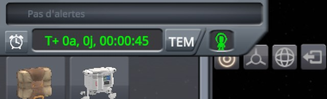
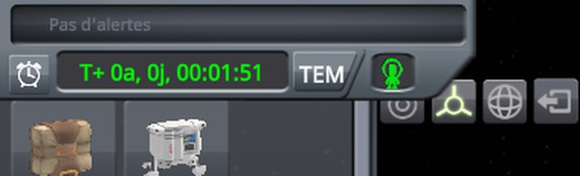
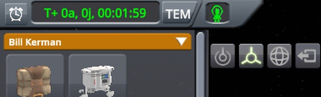
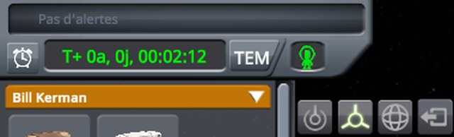
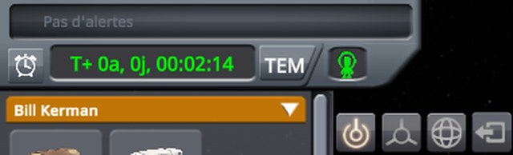
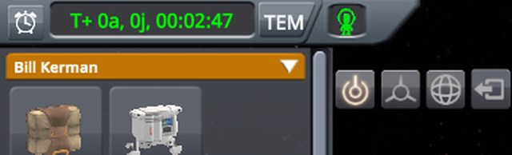

# Checking the construction mode with the next alarm

Part of [Construction Toolbar Fix](../README.md). In EVA construction mode, the alarm clock button shows the
next alarm above the time display. The Move tool is clicked, then the top of the Place tool, and the pointer
rests on the first row of the list of parts; the next alarm is hidden again, and the two tools clicked again. Do
the tools and the list stay out from under the time display? Played without this mod, then with it.

## The install

KSP 1.12.5 with KSP Community Fixes 1.41.1, in French, in a 1280 × 720 window, interface at 100 %, with
Construction Toolbar Fix 0.1.0 at `Debug` for *With this mod*.
[KSP-Util-MCPServer](https://github.com/lhervier/KSP-Util-MCPServer) is installed in both, to play the
protocol by script.

## The protocol

The save is [construction-toolbar.sfs](../diag/construction-toolbar.sfs): a small capsule on the launch pad of
a sandbox game, at night, its engineer, Bill, out on EVA next to it. Copy it into the folder of a sandbox game,
and load it.

1. Open the construction mode.
2. Click the alarm clock button, left of the time display: the next alarm shows above it (*Pas d'alertes*, no
   alarm set), and the time display slides down.
3. Click the middle of the Move tool.
4. Click the top of the Place tool, a quarter of the way down.
5. Rest the pointer on the middle of the first row of the list of parts, Bill's inventory.
6. Click the alarm clock button again, which hides the next alarm.
7. Click the middle of the Move tool, then the top of the Place tool.

**Played by a script.** [run-tools.py](../diag/automation/run-tools.py) plays it through KSP-Util-MCPServer.
Python 3 only, nothing to install: start KSP with KSP-Util-MCPServer, copy the save into a sandbox game, then
run `python run-tools.py --folder <your sandbox game> --protocol alarm --out out`. It moves the pointer and
clicks with the mouse tools of KSP-Util-MCPServer, and finds what it clicks by moving the pointer over the
screen first and reading what lies under it. It finds the alarm clock button, the tools and the first row of the
list again after the next alarm shows, where they are then. Between two steps, the pointer rests in the middle
of the screen for two seconds, long enough for the drawer to close. It ends with the checks of this protocol,
each printed PASS or FAIL, and exits with 1 when one fails: without this mod, the checks marked (fix) fail.

A screenshot follows each step, the pointer resting, but for the steps where it stays on a point: screenshots do
not show the mouse cursor, so it is drawn where it was. The images below are the top left of the screen, zoomed
to 640 pixels wide.

## On stock

Read off the screenshots below:

| Step | Tool selected | What shows |
|---|---|---|
| 1. Construction mode open | Place | the first row, *Bill Kerman*, and the tools |
| 2. Click on the alarm clock button | Place | **the time display over the first row and the top of the tools** |
| 3. Click on the middle of the Move tool | Move | the same |
| 4. Click on the top of the Place tool | **Move** | the same |
| 5. Pointer on the first row | Move | **the drawer open, the pointer on the time warp buttons** |
| 6. Click on the alarm clock button again | Move | the first row and the tools |
| 7. Clicks on the Move tool, then on the top of the Place tool | **Move** | the first row and the tools |

The time display slides down over the construction mode, which stays where it is: the click on the top of the
Place tool reaches the time display, and the pointer meant for the first row of the list opens the drawer. Once
the next alarm is hidden, the top of the Place tool is under the drawer's rectangle again (see [Checking the
construction tools](checking-tools.md)).

<p class="thumbs"><a href="../imgs/checking-alarm/stock/0-construction-mode.jpg"></a> <a href="../imgs/checking-alarm/stock/1-click-alarm.jpg"></a> <a href="../imgs/checking-alarm/stock/2-click-move.jpg"></a> <a href="../imgs/checking-alarm/stock/3-click-place-top.jpg"></a> <a href="../imgs/checking-alarm/stock/4-pointer-first-header.jpg"></a> <a href="../imgs/checking-alarm/stock/5-click-alarm-again.jpg"></a> <a href="../imgs/checking-alarm/stock/6-click-place-top-alarm-hidden.jpg"></a></p>

<details>
<summary>The seven screenshots, on stock</summary>

The construction mode open:


After the click on the alarm clock button:


After the click on the middle of the Move tool:


After the click on the top of the Place tool:


The pointer on the first row of the list:


After the click on the alarm clock button again:


After the clicks on the Move tool, then on the top of the Place tool:


</details>

## With this mod

Read off the screenshots below:

| Step | Tool selected | What shows |
|---|---|---|
| 1. Construction mode open | Place | the first row, *Bill Kerman*, and the tools |
| 2. Click on the alarm clock button | Place | **the first row and the tools, moved down below the time display** |
| 3. Click on the middle of the Move tool | Move | the same |
| 4. Click on the top of the Place tool | **Place** | the same |
| 5. Pointer on the first row | Place | **the first row under the pointer** |
| 6. Click on the alarm clock button again | Place | the first row and the tools, back in their place |
| 7. Clicks on the Move tool, then on the top of the Place tool | **Place** | the first row and the tools |

The whole construction mode moves down with the time display, its bottom left in place, and back up
when the next alarm is hidden. The mod's log says so:

```
[KSPFixConstructionToolbar] [DEBUG] Construction mode's block EVA Construction Mode follows the time display
[KSPFixConstructionToolbar] [DEBUG] Next alarm shown: construction mode's block moved down by 32
[KSPFixConstructionToolbar] [DEBUG] Next alarm hidden: construction mode's block back in its place
```

<p class="thumbs"><a href="../imgs/checking-alarm/fix/0-construction-mode.jpg"></a> <a href="../imgs/checking-alarm/fix/1-click-alarm.jpg"></a> <a href="../imgs/checking-alarm/fix/2-click-move.jpg"></a> <a href="../imgs/checking-alarm/fix/3-click-place-top.jpg"></a> <a href="../imgs/checking-alarm/fix/4-pointer-first-header.jpg"></a> <a href="../imgs/checking-alarm/fix/5-click-alarm-again.jpg"></a> <a href="../imgs/checking-alarm/fix/6-click-place-top-alarm-hidden.jpg"></a></p>

<details>
<summary>The seven screenshots, with this mod</summary>

The construction mode open:


After the click on the alarm clock button:


After the click on the middle of the Move tool:


After the click on the top of the Place tool:


The pointer on the first row of the list:


After the click on the alarm clock button again:


After the clicks on the Move tool, then on the top of the Place tool:


</details>
