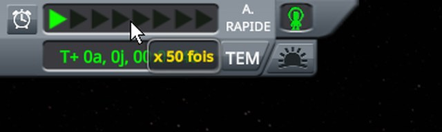
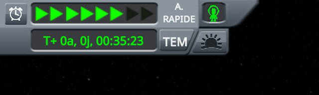
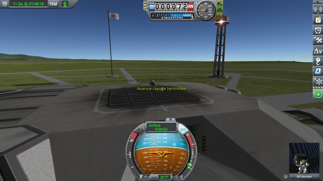
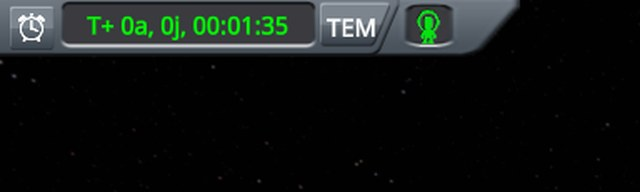
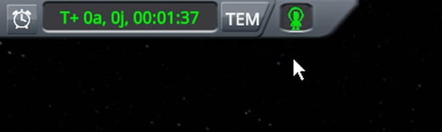
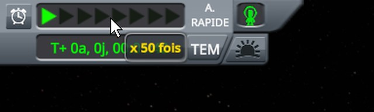
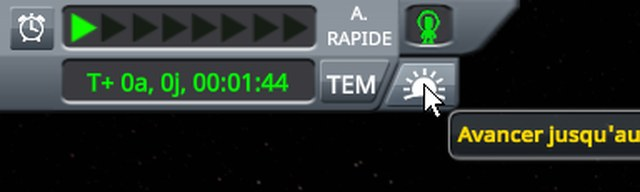
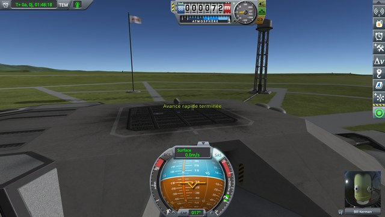

# Checking the warp-to-morning drawer

Part of [Construction Toolbar Fix](../README.md). Out of the construction mode, the pointer rests below the time
display, then on its date, then goes to the sunrise button of its drawer and clicks it. Does the drawer still
open from the time display, and only from there? Played without this mod, then with it.

## The install

KSP 1.12.5 with KSP Community Fixes 1.41.1, in French, in a 1280 × 720 window, interface at 100 %, with
Construction Toolbar Fix 0.1.0 at `Debug` for *With this mod*.
[KSP-Util-MCPServer](https://github.com/lhervier/KSP-Util-MCPServer) is installed in both, to play the
protocol by script.

## The protocol

The save is [construction-toolbar.sfs](../diag/construction-toolbar.sfs): a small capsule on the launch pad of
a sandbox game, at night, its engineer, Bill, out on EVA next to it. Copy it into the folder of a sandbox game,
and load it.

1. Rest the pointer below the time display, on the middle of where the sunrise button shows when the
   drawer is open, the drawer closed.
2. Rest the pointer on the date of the time display.
3. Move it from there to the middle of the sunrise button, as a hand does, and rest it there.
4. Click.
5. Let the warp end.

**Played by a script.** [run-tools.py](../diag/automation/run-tools.py) plays it through KSP-Util-MCPServer.
Python 3 only, nothing to install: start KSP with KSP-Util-MCPServer, copy the save into a sandbox game, then
run `python run-tools.py --folder <your sandbox game> --protocol drawer --out out`. It moves the pointer and
clicks with the mouse tools of KSP-Util-MCPServer, and finds what it clicks by moving the pointer over the
screen first and reading what lies under it. It finds the date and the sunrise button with the drawer held open
by a time warp at 5x, which keeps it open whatever the pointer does; the date is then put back on the first row
where it shows, the drawer closed. Between two steps, the pointer rests in the middle of the screen for two
seconds, long enough for the drawer to close. It ends with the checks of this protocol, each printed PASS or
FAIL, and exits with 1 when one fails: without this mod, the checks marked (fix) fail.

A screenshot follows each step, the pointer resting, but for the steps where it stays on a point: screenshots do
not show the mouse cursor, so it is drawn where it was. The images below are the top left of the screen, zoomed
to 640 pixels wide.

## On stock

Read off the screenshots below:

| Step | Drawer | Time display |
|---|---|---|
| 1. Pointer below the time display | **open, the sunrise button under the pointer, its tooltip showing** | the clock |
| 2. Pointer on the date | open | the clock |
| 3. Pointer on the sunrise button | open, its tooltip showing | the clock |
| 4. Click on it | open | time warping, six arrows lit |
| 5. Warp over | closed | the morning come, *Warp ended* on screen |

The pointer below the time display, over nothing that shows, opens the drawer.

     

The six screenshots, on stock

At the start:

The pointer below the time display:

The pointer on the date:

The pointer on the sunrise button:

After the click on it:

Once the warp is over, the whole screen:

## With this mod

Read off the screenshots below:

| Step | Drawer | Time display |
|---|---|---|
| 1. Pointer below the time display | **closed** | the clock |
| 2. Pointer on the date | open | the clock |
| 3. Pointer on the sunrise button | open, its tooltip showing | the clock |
| 4. Click on it | open | time warping, six arrows lit |
| 5. Warp over | closed | the morning come, *Warp ended* on screen |

The drawer no longer opens from below the time display; from the date, it opens and warps to the morning as on
stock.

     

The six screenshots, with this mod

At the start:

The pointer below the time display:

The pointer on the date:

The pointer on the sunrise button:

After the click on it:

Once the warp is over, the whole screen:

