# Checking other screen sizes and interface scales

Part of [Construction Toolbar Fix](../README.md). The size of the window, the interface scale and the time
display's own scale change the size and the place of the time display, of its drawer and of the construction
mode. The three protocols, [the construction tools](checking-tools.md), [the warp-to-morning
drawer](checking-drawer.md) and [the construction mode with the next alarm](checking-alarm.md), are played again
in six configurations. Do the tools, the drawer and the list of parts still respond? Played without this mod,
then with it, in each.

## The install

The same as for [the construction tools](checking-tools.md#the-install), but in a window of another size, given
to KSP when it starts (`-screen-width`, `-screen-height`), and with the scales set by hand in KSP's
`settings.cfg` before KSP starts:

- **1280 × 720, interface at 80 %**: `UI_SCALE = 0.8`, the other scales left at 1.
- **1280 × 720, interface at 150 %**: `UI_SCALE = 1.5`, the other scales left at 1.
- **1280 × 720, time display alone at 80 %**: `UI_SCALE = 1`, `UI_SCALE_TIME = 0.8`, the other scales left at 1.
- **1280 × 720, time display alone at 150 %**: `UI_SCALE = 1`, `UI_SCALE_TIME = 1.5`, the other scales left at 1.
- **1920 × 1080, interface at 100 %**: `UI_SCALE = 1`, the other scales left at 1.
- **1920 × 1080, interface at 150 %**: `UI_SCALE = 1.5`, the other scales left at 1.

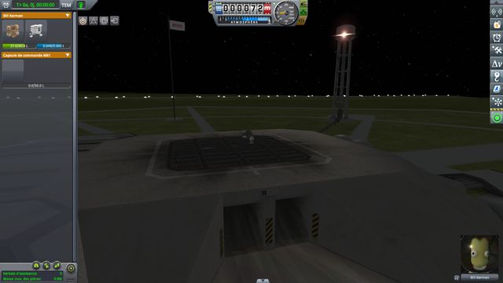

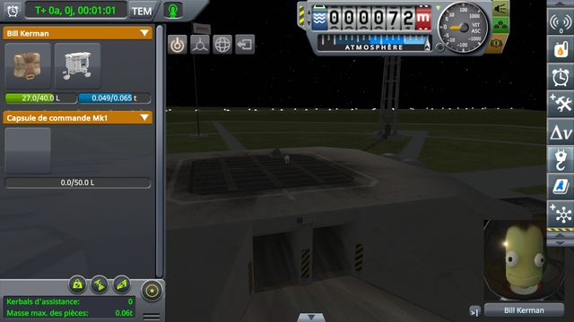

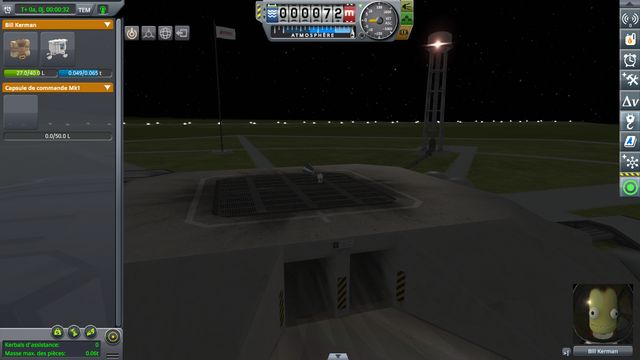

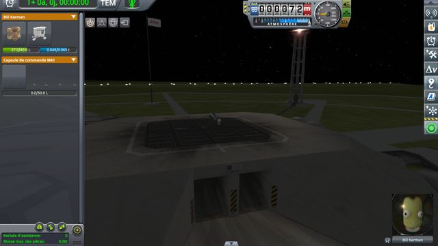

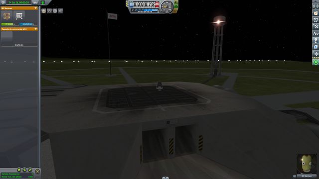

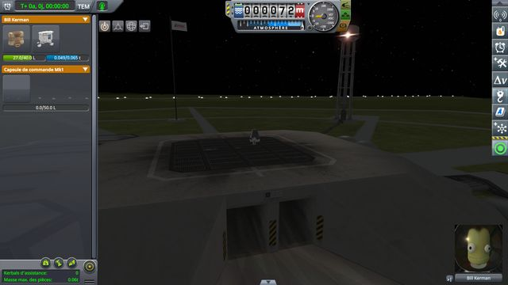

## The protocol

The three protocols, with their save, [construction-toolbar.sfs](../diag/construction-toolbar.sfs), played by
[run-tools.py](../diag/automation/run-tools.py) with `--protocol all`: it finds the tools, the date, the drawer,
the alarm clock button and the first row of the list whatever their size, and crops the screenshots to the top
left of the screen. The pointer drawn on the screenshots keeps its size: the system's pointer does not follow
the interface scale.

Below, for each configuration, what the screenshots of the steps that matter show, then those screenshots. The
selected tool shows lit: the Place tool orange, the Move tool green, the Rotate tool pink.

## 1280 × 720, interface at 80 %

Read off the screenshots below:

| Step | Stock | This mod |
|---|---|---|
| Construction tools: click on the middle of the Move tool | Move lit | Move lit |
| Pointer on the top of the Place tool | **the drawer open, the sunrise button under the pointer** | the Place tool's tooltip |
| Click there | **time warping**, Move still lit | **Place lit** |
| Click on the middle of the Place tool, the Rotate tool selected | **Rotate still lit** | **Place lit** |
| Drawer: pointer below the time display | **the drawer open, the sunrise button under the pointer** | **the drawer closed** |
| From the date, click on the sunrise button | time warping, then morning | time warping, then morning |
| Next alarm: click on the alarm clock button | **the time display over the first row and the top of the tools** | **the first row and the tools moved down below the time display** |
| Clicks on the middle of the Move tool, then on the top of the Place tool | Move lit, **still lit after the second click** | Move lit, **then Place lit** |

As at 100 %: on stock, the drawer opens under the pointer from the top of the Place tool, whose clicks are lost,
and the time display covers the construction mode once the next alarm shows. With this mod, every tool responds
and the construction mode moves down below the time display.

<a href="../imgs/checking-interface-scales/window-720-interface-80/stock/tools-1-click-move.jpg">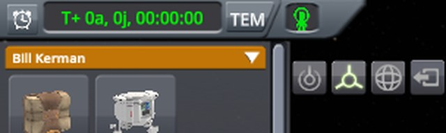</a> <a href="../imgs/checking-interface-scales/window-720-interface-80/stock/tools-2-pointer-place-top.jpg">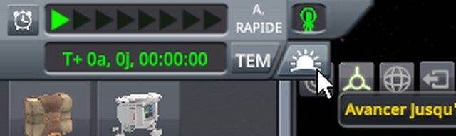</a> <a href="../imgs/checking-interface-scales/window-720-interface-80/stock/tools-3-click-place-top.jpg">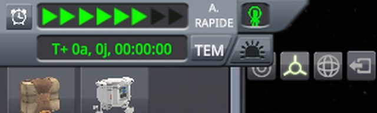</a> <a href="../imgs/checking-interface-scales/window-720-interface-80/stock/tools-5-click-place-middle.jpg">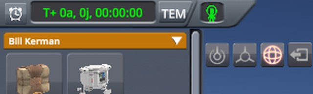</a> <a href="../imgs/checking-interface-scales/window-720-interface-80/stock/drawer-1-pointer-below-time.jpg">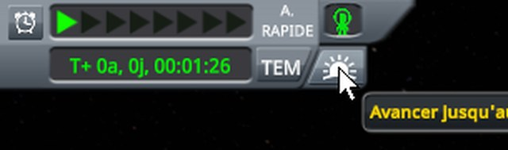</a> <a href="../imgs/checking-interface-scales/window-720-interface-80/stock/alarm-1-click-alarm.jpg">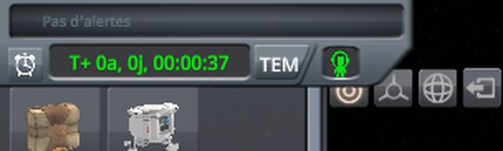</a> <a href="../imgs/checking-interface-scales/window-720-interface-80/stock/alarm-3-click-place-top.jpg">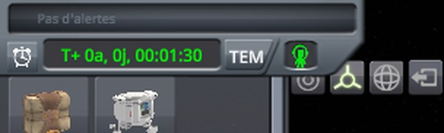</a>

The seven screenshots, 1280 × 720, interface at 80 %, on stock

After the click on the middle of the Move tool:

The pointer on the top of the Place tool:

After the click there:

After the click on the middle of the Place tool:

Out of construction mode, the pointer below the time display:

In construction mode, after the click on the alarm clock button:

The next alarm showing, after the click on the top of the Place tool:

 <a href="../imgs/checking-interface-scales/window-720-interface-80/fix/tools-2-pointer-place-top.jpg">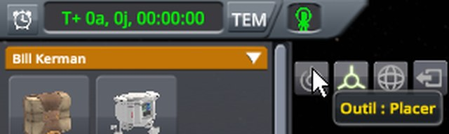</a>  <a href="../imgs/checking-interface-scales/window-720-interface-80/fix/tools-5-click-place-middle.jpg">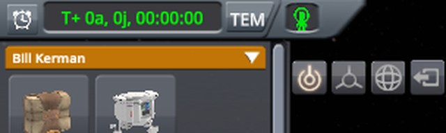</a> <a href="../imgs/checking-interface-scales/window-720-interface-80/fix/drawer-1-pointer-below-time.jpg">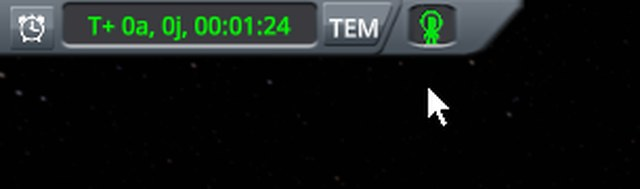</a>  

The seven screenshots, 1280 × 720, interface at 80 %, with this mod

After the click on the middle of the Move tool:

The pointer on the top of the Place tool:

After the click there:

After the click on the middle of the Place tool:

Out of construction mode, the pointer below the time display:

In construction mode, after the click on the alarm clock button:

The next alarm showing, after the click on the top of the Place tool:

## 1280 × 720, interface at 150 %

Read off the screenshots below:

| Step | Stock | This mod |
|---|---|---|
| Construction tools: click on the middle of the Move tool | Move lit | Move lit |
| Pointer on the top of the Place tool | **the drawer open, the sunrise button under the pointer** | the Place tool's tooltip |
| Click there | **time warping**, Move still lit | **Place lit** |
| Click on the middle of the Place tool, the Rotate tool selected | **Rotate still lit** | **Place lit** |
| Drawer: pointer below the time display | **the drawer open, the sunrise button under the pointer** | **the drawer closed** |
| From the date, click on the sunrise button | time warping, then morning | time warping, then morning |
| Next alarm: click on the alarm clock button | **the time display over the first row and the top of the tools** | **the first row and the tools moved down below the time display** |
| Clicks on the middle of the Move tool, then on the top of the Place tool | Move lit, **still lit after the second click** | Move lit, **then Place lit** |

As at 100 %: on stock, the drawer opens under the pointer from the top of the Place tool, whose clicks are lost,
and the time display covers the construction mode once the next alarm shows. With this mod, every tool responds
and the construction mode moves down below the time display.

<a href="../imgs/checking-interface-scales/window-720-interface-150/stock/tools-1-click-move.jpg">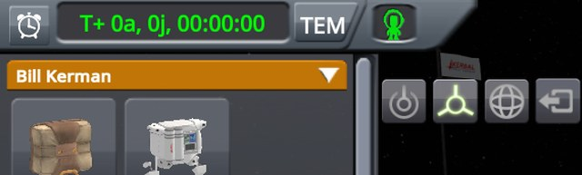</a> <a href="../imgs/checking-interface-scales/window-720-interface-150/stock/tools-2-pointer-place-top.jpg">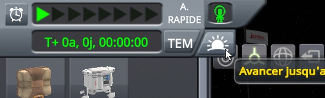</a> <a href="../imgs/checking-interface-scales/window-720-interface-150/stock/tools-3-click-place-top.jpg">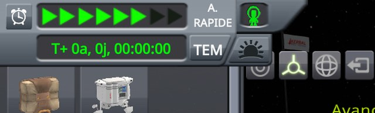</a> <a href="../imgs/checking-interface-scales/window-720-interface-150/stock/tools-5-click-place-middle.jpg">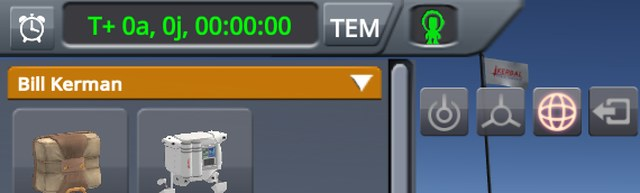</a> <a href="../imgs/checking-interface-scales/window-720-interface-150/stock/drawer-1-pointer-below-time.jpg">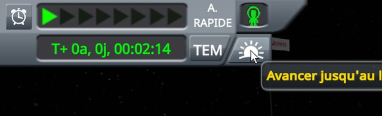</a> <a href="../imgs/checking-interface-scales/window-720-interface-150/stock/alarm-1-click-alarm.jpg">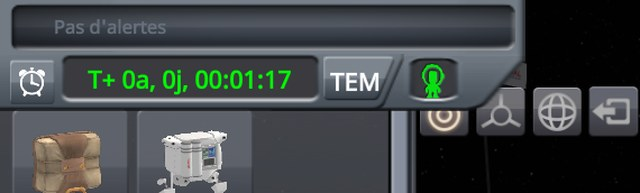</a> <a href="../imgs/checking-interface-scales/window-720-interface-150/stock/alarm-3-click-place-top.jpg">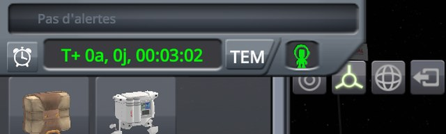</a>

The seven screenshots, 1280 × 720, interface at 150 %, on stock

After the click on the middle of the Move tool:

The pointer on the top of the Place tool:

After the click there:

After the click on the middle of the Place tool:

Out of construction mode, the pointer below the time display:

In construction mode, after the click on the alarm clock button:

The next alarm showing, after the click on the top of the Place tool:

<a href="../imgs/checking-interface-scales/window-720-interface-150/fix/tools-1-click-move.jpg">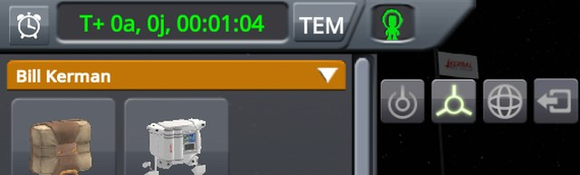</a> <a href="../imgs/checking-interface-scales/window-720-interface-150/fix/tools-2-pointer-place-top.jpg">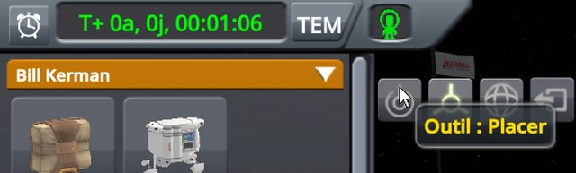</a> <a href="../imgs/checking-interface-scales/window-720-interface-150/fix/tools-3-click-place-top.jpg">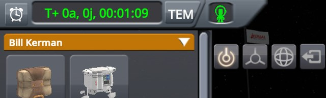</a>  <a href="../imgs/checking-interface-scales/window-720-interface-150/fix/drawer-1-pointer-below-time.jpg">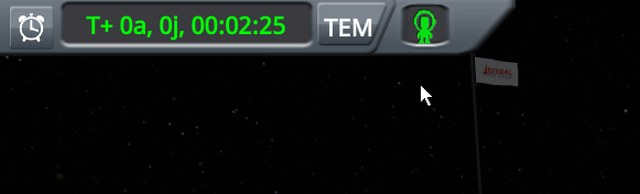</a> <a href="../imgs/checking-interface-scales/window-720-interface-150/fix/alarm-1-click-alarm.jpg">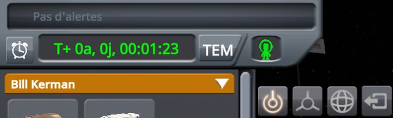</a> 

The seven screenshots, 1280 × 720, interface at 150 %, with this mod

After the click on the middle of the Move tool:

The pointer on the top of the Place tool:

After the click there:

After the click on the middle of the Place tool:

Out of construction mode, the pointer below the time display:

In construction mode, after the click on the alarm clock button:

The next alarm showing, after the click on the top of the Place tool:

## 1280 × 720, time display alone at 80 %

Read off the screenshots below:

| Step | Stock | This mod |
|---|---|---|
| Construction tools: click on the middle of the Move tool | Move lit | Move lit |
| Pointer on the top of the Place tool | the Place tool's tooltip | the Place tool's tooltip |
| Click there | Place lit | Place lit |
| Click on the middle of the Place tool, the Rotate tool selected | Place lit | Place lit |
| Drawer: pointer below the time display | **the drawer open, the sunrise button under the pointer** | **the drawer closed** |
| From the date, click on the sunrise button | time warping, then morning | time warping, then morning |
| Next alarm: click on the alarm clock button | **the time display over the first row**, the tools clear | **the first row and the tools moved down below the time display** |
| Clicks on the middle of the Move tool, then on the top of the Place tool | Move lit, then Place lit | Move lit, then Place lit |

With the time display alone at 80 %, its drawer's rectangle shrinks with it and no longer reaches the tools: on
stock, they respond, but the pointer below the time display still opens the drawer, and with the next alarm
shown, the time display still covers the first row of the list, where the pointer opens the drawer. With this
mod, the drawer stays closed there and the construction mode moves down below the time display.

    <a href="../imgs/checking-interface-scales/window-720-time-80/stock/drawer-1-pointer-below-time.jpg">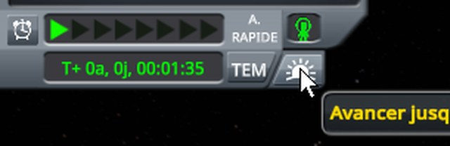</a>  <a href="../imgs/checking-interface-scales/window-720-time-80/stock/alarm-3-click-place-top.jpg">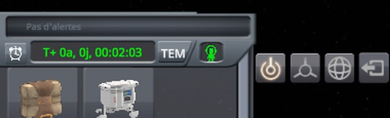</a>

The seven screenshots, 1280 × 720, time display alone at 80 %, on stock

After the click on the middle of the Move tool:

The pointer on the top of the Place tool:

After the click there:

After the click on the middle of the Place tool:

Out of construction mode, the pointer below the time display:

In construction mode, after the click on the alarm clock button:

The next alarm showing, after the click on the top of the Place tool:

<a href="../imgs/checking-interface-scales/window-720-time-80/fix/tools-1-click-move.jpg">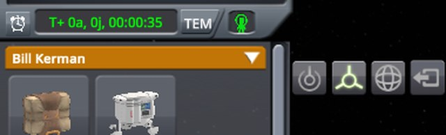</a> <a href="../imgs/checking-interface-scales/window-720-time-80/fix/tools-2-pointer-place-top.jpg">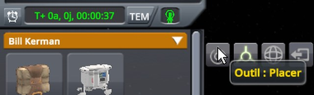</a>  <a href="../imgs/checking-interface-scales/window-720-time-80/fix/tools-5-click-place-middle.jpg">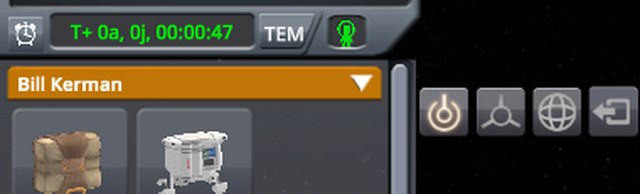</a> <a href="../imgs/checking-interface-scales/window-720-time-80/fix/drawer-1-pointer-below-time.jpg">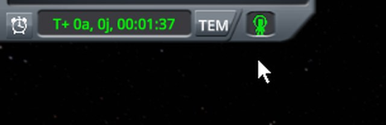</a> <a href="../imgs/checking-interface-scales/window-720-time-80/fix/alarm-1-click-alarm.jpg">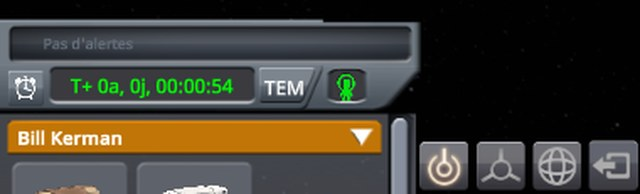</a> <a href="../imgs/checking-interface-scales/window-720-time-80/fix/alarm-3-click-place-top.jpg">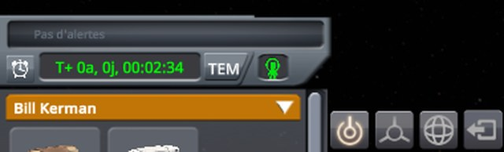</a>

The seven screenshots, 1280 × 720, time display alone at 80 %, with this mod

After the click on the middle of the Move tool:

The pointer on the top of the Place tool:

After the click there:

After the click on the middle of the Place tool:

Out of construction mode, the pointer below the time display:

In construction mode, after the click on the alarm clock button:

The next alarm showing, after the click on the top of the Place tool:

## 1280 × 720, time display alone at 150 %

Read off the screenshots below:

| Step | Stock | This mod |
|---|---|---|
| Construction tools: click on the middle of the Move tool | **Place still lit** | Move lit |
| Pointer on the top of the Place tool | **the drawer open, the time display slid down under the pointer** | the Place tool's tooltip |
| Click there | **Place still lit**, no time warp | **Place lit** |
| Click on the middle of the Place tool, the Rotate tool selected | **Place still lit**, the click on the Rotate tool lost too | **Place lit** |
| Drawer: pointer below the time display | **the drawer open, the sunrise button under the pointer** | **the drawer closed** |
| From the date, click on the sunrise button | time warping, then morning | time warping, then morning |
| Next alarm: click on the alarm clock button | **the time display over the first row and most of the tools** | **the first row and the tools moved down below the time display** |
| Clicks on the middle of the Move tool, then on the top of the Place tool | **the tools under the time display** | Move lit, **then Place lit** |

With the time display alone at 150 %, its drawer's rectangle grows with it, at the top of the screen where the
time display is partly cut off: on stock, it reaches over the middle of the Move and Rotate tools too, whose
clicks are lost as well, and the click on the top of the Place tool lands on the time display slid down; once
the next alarm is hidden again, that click even switches the clock from the mission time to the date. With this
mod, every tool responds, and the construction mode moves down below the time display.

<a href="../imgs/checking-interface-scales/window-720-time-150/stock/tools-1-click-move.jpg">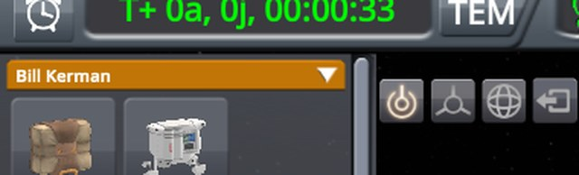</a> <a href="../imgs/checking-interface-scales/window-720-time-150/stock/tools-2-pointer-place-top.jpg">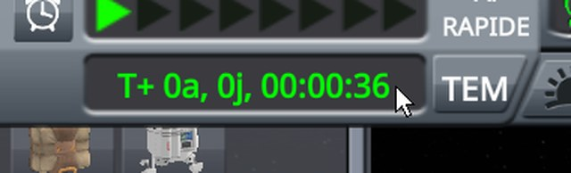</a>  <a href="../imgs/checking-interface-scales/window-720-time-150/stock/tools-5-click-place-middle.jpg">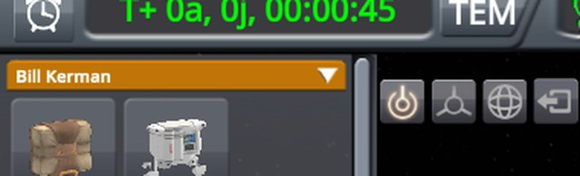</a> <a href="../imgs/checking-interface-scales/window-720-time-150/stock/drawer-1-pointer-below-time.jpg">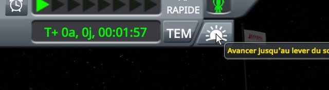</a>  <a href="../imgs/checking-interface-scales/window-720-time-150/stock/alarm-3-click-place-top.jpg">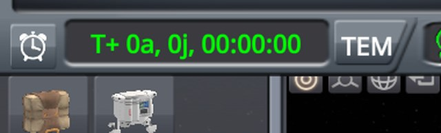</a>

The seven screenshots, 1280 × 720, time display alone at 150 %, on stock

After the click on the middle of the Move tool:

The pointer on the top of the Place tool:

After the click there:

After the click on the middle of the Place tool:

Out of construction mode, the pointer below the time display:

In construction mode, after the click on the alarm clock button:

The next alarm showing, after the click on the top of the Place tool:

<a href="../imgs/checking-interface-scales/window-720-time-150/fix/tools-1-click-move.jpg">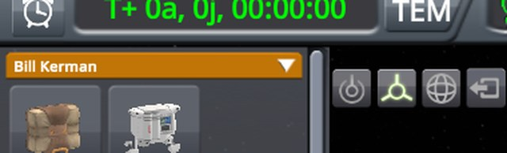</a> <a href="../imgs/checking-interface-scales/window-720-time-150/fix/tools-2-pointer-place-top.jpg">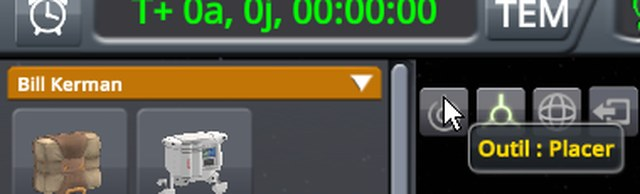</a> <a href="../imgs/checking-interface-scales/window-720-time-150/fix/tools-3-click-place-top.jpg">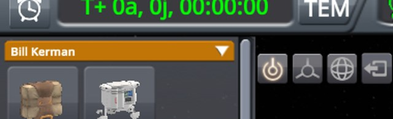</a>  <a href="../imgs/checking-interface-scales/window-720-time-150/fix/drawer-1-pointer-below-time.jpg">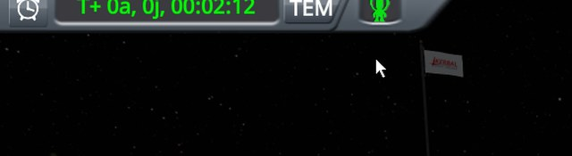</a> <a href="../imgs/checking-interface-scales/window-720-time-150/fix/alarm-1-click-alarm.jpg">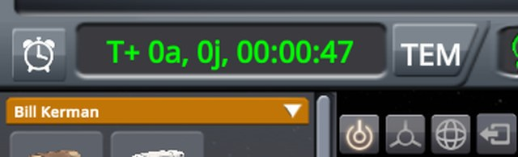</a> <a href="../imgs/checking-interface-scales/window-720-time-150/fix/alarm-3-click-place-top.jpg">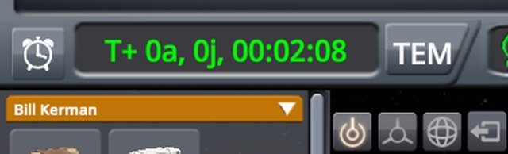</a>

The seven screenshots, 1280 × 720, time display alone at 150 %, with this mod

After the click on the middle of the Move tool:

The pointer on the top of the Place tool:

After the click there:

After the click on the middle of the Place tool:

Out of construction mode, the pointer below the time display:

In construction mode, after the click on the alarm clock button:

The next alarm showing, after the click on the top of the Place tool:

## 1920 × 1080, interface at 100 %

Read off the screenshots below:

| Step | Stock | This mod |
|---|---|---|
| Construction tools: click on the middle of the Move tool | Move lit | Move lit |
| Pointer on the top of the Place tool | **the drawer open, the sunrise button under the pointer** | the Place tool's tooltip |
| Click there | **time warping**, Move still lit | **Place lit** |
| Click on the middle of the Place tool, the Rotate tool selected | **Rotate still lit** | **Place lit** |
| Drawer: pointer below the time display | **the drawer open, the sunrise button under the pointer** | **the drawer closed** |
| From the date, click on the sunrise button | time warping, then morning | time warping, then morning |
| Next alarm: click on the alarm clock button | **the time display over the first row and the top of the tools** | **the first row and the tools moved down below the time display** |
| Clicks on the middle of the Move tool, then on the top of the Place tool | **nothing changes what is lit** | Move lit, **then Place lit** |

As at 1280 × 720, but with the next alarm shown, the click on the middle of the Move tool is lost too on stock.
With this mod, every tool responds and the construction mode moves down below the time display.

<a href="../imgs/checking-interface-scales/window-1080-interface-100/stock/tools-1-click-move.jpg">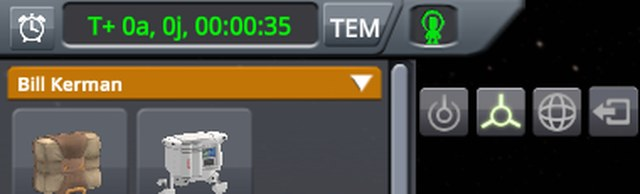</a> <a href="../imgs/checking-interface-scales/window-1080-interface-100/stock/tools-2-pointer-place-top.jpg">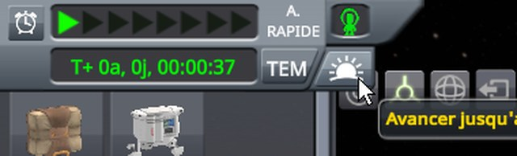</a>  <a href="../imgs/checking-interface-scales/window-1080-interface-100/stock/tools-5-click-place-middle.jpg">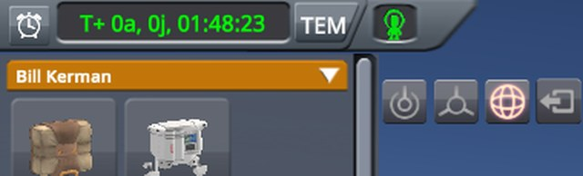</a>   

The seven screenshots, 1920 × 1080, interface at 100 %, on stock

After the click on the middle of the Move tool:

The pointer on the top of the Place tool:

After the click there:

After the click on the middle of the Place tool:

Out of construction mode, the pointer below the time display:

In construction mode, after the click on the alarm clock button:

The next alarm showing, after the click on the top of the Place tool:

      

The seven screenshots, 1920 × 1080, interface at 100 %, with this mod

After the click on the middle of the Move tool:

The pointer on the top of the Place tool:

After the click there:

After the click on the middle of the Place tool:

Out of construction mode, the pointer below the time display:

In construction mode, after the click on the alarm clock button:

The next alarm showing, after the click on the top of the Place tool:

## 1920 × 1080, interface at 150 %

Read off the screenshots below:

| Step | Stock | This mod |
|---|---|---|
| Construction tools: click on the middle of the Move tool | Move lit | Move lit |
| Pointer on the top of the Place tool | **the drawer open, the sunrise button under the pointer** | the Place tool's tooltip |
| Click there | **time warping**, Move still lit | **Place lit** |
| Click on the middle of the Place tool, the Rotate tool selected | **Rotate still lit** | **Place lit** |
| Drawer: pointer below the time display | **the drawer open, the sunrise button under the pointer** | **the drawer closed** |
| From the date, click on the sunrise button | time warping, then morning | time warping, then morning |
| Next alarm: click on the alarm clock button | **the time display over the first row and the top of the tools** | **the first row and the tools moved down below the time display** |
| Clicks on the middle of the Move tool, then on the top of the Place tool | **nothing changes what is lit** | Move lit, **then Place lit** |

As in 1920 × 1080 at 100 %. With this mod, every tool responds and the construction mode moves down below the
time display.

      

The seven screenshots, 1920 × 1080, interface at 150 %, on stock

After the click on the middle of the Move tool:

The pointer on the top of the Place tool:

After the click there:

After the click on the middle of the Place tool:

Out of construction mode, the pointer below the time display:

In construction mode, after the click on the alarm clock button:

The next alarm showing, after the click on the top of the Place tool:

      

The seven screenshots, 1920 × 1080, interface at 150 %, with this mod

After the click on the middle of the Move tool:

The pointer on the top of the Place tool:

After the click there:

After the click on the middle of the Place tool:

Out of construction mode, the pointer below the time display:

In construction mode, after the click on the alarm clock button:

The next alarm showing, after the click on the top of the Place tool:

