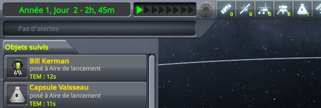
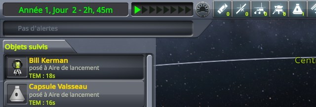
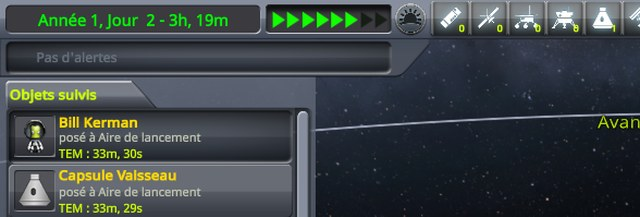
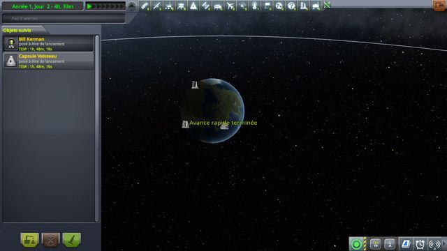
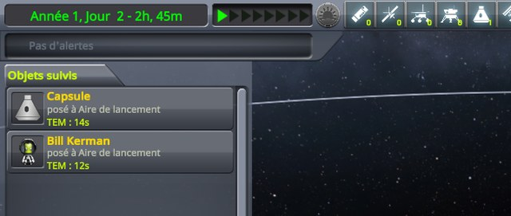
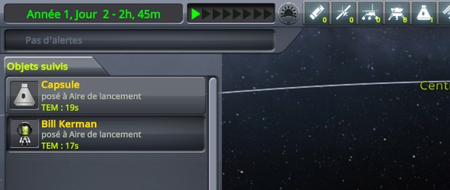
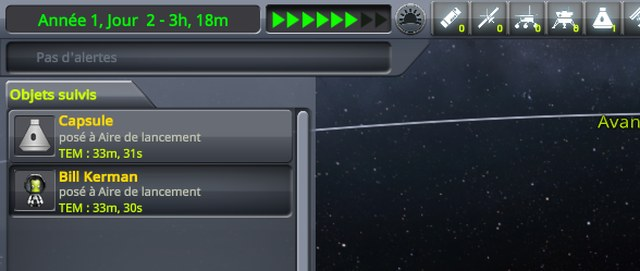
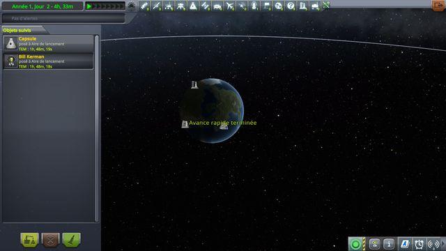

# Checking the tracking station

Part of [Construction Toolbar Fix](../README.md). The tracking station shows the time too, with a
warp-to-morning button. In flight, that button sits in a drawer that slides out of the time display when the
pointer is over it, the drawer this mod changes; in the tracking station, it is always shown, right of the time
warp buttons, and has no drawer. Does it still warp to the morning? Played without this mod, then with it.

## The install

The same as for [the construction tools](checking-tools.md#the-install).

## The protocol

The save is [construction-toolbar.sfs](../diag/construction-toolbar.sfs), loaded into flight as for the other
protocols, then the tracking station entered from the flight.

1. Look at the warp-to-morning button, the sun at the top of the screen, nothing selected.
2. Click it.
3. Click the kerbal's row, *Bill Kerman*, in the list of tracked objects.
4. Click the warp-to-morning button again.
5. Let the warp end.

**Played by a script.** [run-tools.py](../diag/automation/run-tools.py) plays it with `--protocol station`, and
checks that the click on the button, the kerbal selected, warps to the morning. The capsule sometimes breaks up
on the launch pad as the save loads, with or without this mod; the station then shows the kerbal's row lit
though nothing is selected, and a click on it does nothing, a defect of the station of its own: the script then
loads the save again. The images below are the top left of the screen, zoomed to 640 pixels wide; the last one
is the whole screen.

## The results

Read off the screenshots below:

| Step | Stock | This mod |
|---|---|---|
| 1. Station open, nothing selected | the sun button grey | the sun button grey |
| 2. Click on the sun button | nothing happens | nothing happens |
| 3. Click on the kerbal's row | Bill selected, the sun button lit | Bill selected, the sun button lit |
| 4. Click on the sun button | time warping, six arrows lit | time warping, six arrows lit |
| 5. Warp over | *Warp ended* on screen | *Warp ended* on screen |

The same on stock and with this mod: the button greyed until a vessel is selected, then the warp to the morning.
In the log, at `Debug`, the mod writes no line in the tracking station: it finds no drawer there.

## On stock

    

The five screenshots, on stock

The tracking station, nothing selected:

After the click on the warp-to-morning button:

After the click on the kerbal's row:

After the click on the warp-to-morning button:

Once the warp is over, the whole screen:

## With this mod

    

The five screenshots, with this mod

The tracking station, nothing selected:

After the click on the warp-to-morning button:

After the click on the kerbal's row:

After the click on the warp-to-morning button:

Once the warp is over, the whole screen:

