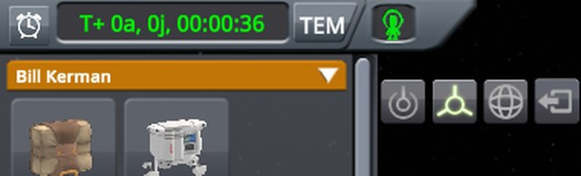
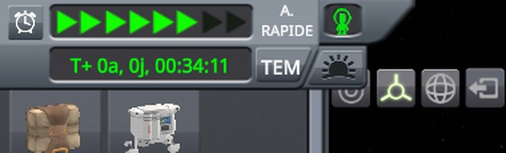
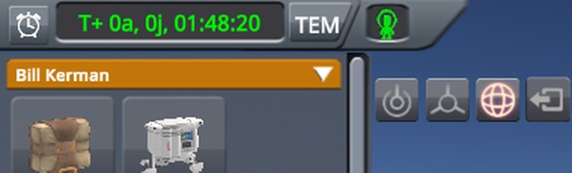
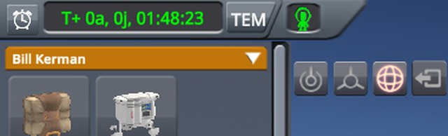
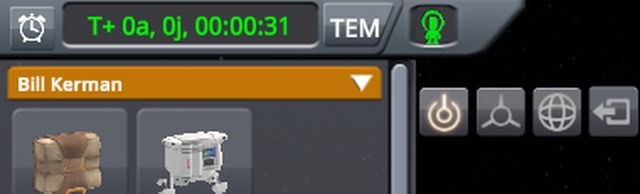
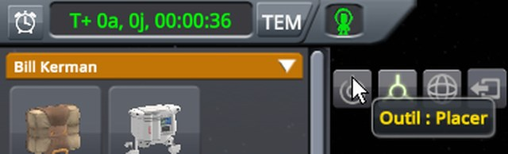
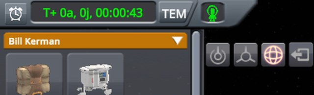

# Checking the construction tools

Part of [Construction Toolbar Fix](../README.md). In EVA construction mode, the Move tool is clicked, then the
pointer rests on the top of the Place tool and clicks there; then the Rotate tool, and the middle of the Place
tool. Does each tool take its click? Played without this mod, then with it.

## The install

KSP 1.12.5 with KSP Community Fixes 1.41.1, in French, in a 1280 × 720 window, interface at 100 %, with
Construction Toolbar Fix 0.1.0 at `Debug` for *With this mod*.
[KSP-Util-MCPServer](https://github.com/lhervier/KSP-Util-MCPServer) is installed in both, to play the
protocol by script.

## The protocol

The save is [construction-toolbar.sfs](../diag/construction-toolbar.sfs): a small capsule on the launch pad of
a sandbox game, at night, its engineer, Bill, out on EVA next to it. Copy it into the folder of a sandbox game,
and load it.

1. Open the construction mode (Bill is an engineer). The Place tool, the first of the four buttons right of
   the list of parts, is selected: it shows orange.
2. Click the middle of the Move tool, the second button.
3. Move the pointer from the middle of the screen onto the top of the Place tool, a quarter of the way down,
   and rest it there.
4. Click there.
5. If time warps, let it end. Click the middle of the Rotate tool, the third button.
6. Click the middle of the Place tool.

**Played by a script.** [run-tools.py](../diag/automation/run-tools.py) plays it through KSP-Util-MCPServer.
Python 3 only, nothing to install: start KSP with KSP-Util-MCPServer, copy the save into a sandbox game, then
run `python run-tools.py --folder <your sandbox game> --protocol tools --out out`. It moves the pointer and
clicks with the mouse tools of KSP-Util-MCPServer, and finds what it clicks by moving the pointer over the
screen first and reading what lies under it. It finds each tool as the rectangle over which it lies under the
pointer, whatever lies over it. It opens the construction mode as its button in the toolbar does. Between two
steps, the pointer rests in the middle of the screen for two seconds, long enough for the drawer to close. It
ends with the checks of this protocol, each printed PASS or FAIL, and exits with 1 when one fails: without this
mod, the checks marked (fix) fail.

A screenshot follows each step, the pointer resting, but for the steps where it stays on a point: screenshots do
not show the mouse cursor, so it is drawn where it was. The images below are the top left of the screen, zoomed
to 640 pixels wide.

## On stock

Read off the screenshots below:

| Step | Tool selected | Time display |
|---|---|---|
| 1. Construction mode open | Place | the clock, the drawer closed |
| 2. Click on the middle of the Move tool | Move | the clock |
| 3. Pointer on the top of the Place tool | Move | **the drawer open, its sunrise button under the pointer, its tooltip showing** |
| 4. Click there | **Move** | **time warping, six arrows lit** |
| 5. Click on the middle of the Rotate tool | Rotate | the clock, the morning come |
| 6. Click on the middle of the Place tool | **Rotate** | the clock |

The pointer on the top of the Place tool slides the drawer down, and the click there warps to the morning
instead of selecting the tool. The click on the middle of the Place tool does nothing either: the Rotate tool
stays selected.

<p class="thumbs"><a href="../imgs/checking-tools/stock/0-construction-mode.jpg"></a> <a href="../imgs/checking-tools/stock/1-click-move.jpg"></a> <a href="../imgs/checking-tools/stock/2-pointer-place-top.jpg"></a> <a href="../imgs/checking-tools/stock/3-click-place-top.jpg"></a> <a href="../imgs/checking-tools/stock/4-click-rotate.jpg"></a> <a href="../imgs/checking-tools/stock/5-click-place-middle.jpg"></a></p>

<details>
<summary>The six screenshots, on stock</summary>

The construction mode open:


After the click on the middle of the Move tool:


The pointer on the top of the Place tool:


After the click there:


After the click on the middle of the Rotate tool:


After the click on the middle of the Place tool:


</details>

## With this mod

Read off the screenshots below:

| Step | Tool selected | Time display |
|---|---|---|
| 1. Construction mode open | Place | the clock, the drawer closed |
| 2. Click on the middle of the Move tool | Move | the clock |
| 3. Pointer on the top of the Place tool | Move | the clock, **the Place tool's tooltip showing** |
| 4. Click there | **Place** | the clock |
| 5. Click on the middle of the Rotate tool | Rotate | the clock |
| 6. Click on the middle of the Place tool | **Place** | the clock |

The drawer stays closed, and both clicks on the Place tool select it. The mod's log says where it put
its filter:

```
[KSPFixConstructionToolbar] [DEBUG] Filter put on the drawer mask WarpToSunriseMask of TimeQuadrant
```

<p class="thumbs"><a href="../imgs/checking-tools/fix/0-construction-mode.jpg"></a> <a href="../imgs/checking-tools/fix/1-click-move.jpg"></a> <a href="../imgs/checking-tools/fix/2-pointer-place-top.jpg"></a> <a href="../imgs/checking-tools/fix/3-click-place-top.jpg"></a> <a href="../imgs/checking-tools/fix/4-click-rotate.jpg"></a> <a href="../imgs/checking-tools/fix/5-click-place-middle.jpg"></a></p>

<details>
<summary>The six screenshots, with this mod</summary>

The construction mode open:


After the click on the middle of the Move tool:


The pointer on the top of the Place tool:


After the click there:


After the click on the middle of the Rotate tool:


After the click on the middle of the Place tool:


</details>
